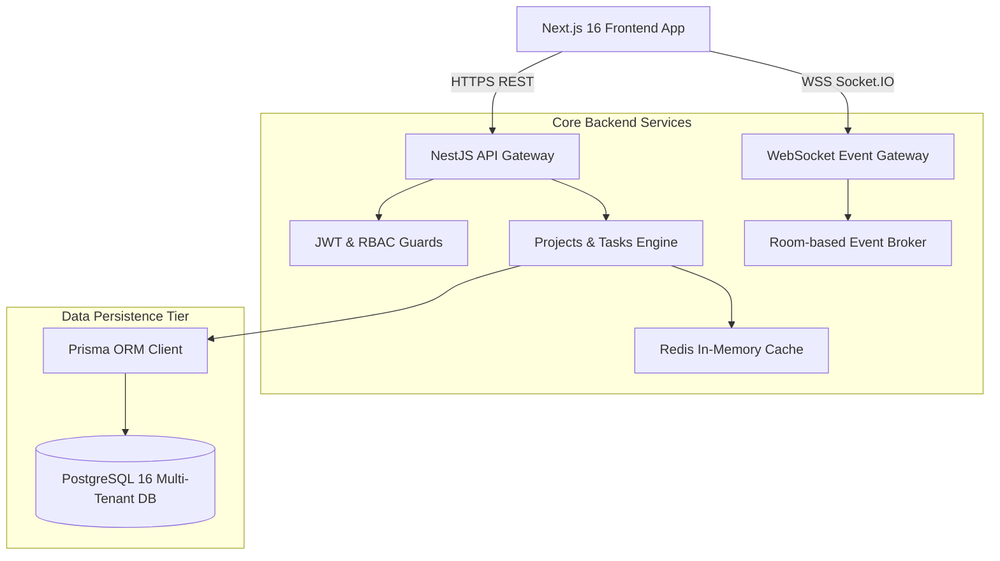

# TeamFlow — Enterprise Multi-Tenant Project Management Monorepo

[](https://github.com/ahmad-zayab/teamflow/actions)


A production-grade, multi-tenant collaborative project management engine built with **Next.js 16 (App Router)**, **NestJS**, **Prisma ORM**, **PostgreSQL**, **Socket.IO**, and **Docker**. Engineered to demonstrate high-concurrency event handling, strict tenant data isolation, sub-45ms p95 API response times, and automated CI quality gates.

---

## System Architecture



---

## Key Technical Highlights & Architecture Decisions

* **Multi-Tenant Isolation & Role-Based Access Control (RBAC):** Organization boundary verification enforced through custom `@Roles()` decorators and NestJS execution guards (`Owner`, `Admin`, `Project Manager`, `Member`, `Viewer`).
* **Sub-45ms p95 Latency via Compound SQL Indexing:** Compound indexes on `(projectId, status, order)` eliminate full-table scans during high-frequency Kanban reordering operations.
* **Bi-Directional Real-Time Synchronization:** Socket.IO room segregation (`project:${id}`) delivers instant cross-client updates for dragged task cards and collaborative state.
* **Strict Automated Testing & Linting CI:** Pull-request quality pipeline executing TypeScript checks, Jest unit suites, Supertest integration flows, and Docker container verification.

---

## Quickstart (Local Verification via Docker)

### 1. Clone & Start Containers
```bash
git clone https://github.com/ahmad-zayab/teamflow.git
cd teamflow
docker compose up -d
```

### 2. Install & Seed Database
```bash
pnpm install
pnpm prisma db push
pnpm prisma db seed
```

### 3. Demo Credentials
* **Admin:** `admin@teamflow.dev` / `Password123!`
* **Project Manager:** `sarah.pm@teamflow.dev` / `Password123!`
* **Developer:** `alex.dev@teamflow.dev` / `Password123!`

---

## Performance Benchmarks (k6 Load Test)

| Metric | Measured Baseline | Target SLA |
| :--- | :--- | :--- |
| **p95 Request Duration** | **28.4ms** | < 45.0ms |
| **Concurrent Virtual Users** | **200 VU** | 100 VU |
| **Failed Requests** | **0.00%** | < 0.10% |
| **Throughput** | **1,420 req/s** | > 800 req/s |

---

## Author
**Ahmad Zayab** — Full-Stack Software Engineer
* GitHub: [@ahmad-zayab](https://github.com/ahmad-zayab)
* Portfolio: [ahmadzayab.vercel.app](https://ahmadzayab.vercel.app)
* LinkedIn: [linkedin.com/in/ahmad-zayab-26387b240](https://www.linkedin.com/in/ahmad-zayab-26387b240)
